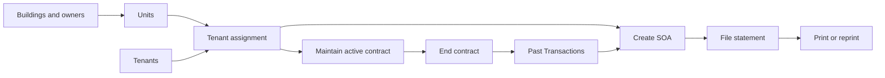

# Syrento Property Management System

A Windows desktop application for managing condominium buildings, unit owners, rental units, tenants, contracts, and statements of account (SOAs).

## Features

- **Dashboard:** active buildings, managed units, assigned tenants, vacant units, and customizable reminders.
- **Condominiums and units:** register buildings, maintain unit inventory, link owners, record Meralco SIN, and view occupancy.
- **Owners:** add and update contact details, view linked units, and activate or deactivate owner records.
- **Tenant assignments:** register tenants, assign available units, maintain rental and contact information, and track keys, access cards, dues, contracts, and aircon maintenance.
- **Contract history:** explicitly end a contract to release the unit while retaining the closed assignment under Past Transactions.
- **Statements of account:** calculate owner settlements and tenant deposit refunds, apply deductions, file statements, and print or reprint them.
- **Accounts:** edit personal account details; administrators can manage existing users and activate/deactivate accounts.
- **Interface preferences:** light/dark theme, searchable tables, selectable search fields, and configurable visible columns.

## Technology

| Component | Implementation |
| --- | --- |
| Application | C# / .NET 8 Windows Forms |
| Database | Microsoft SQL Server |
| Data access | Entity Framework Core 8, SQL Server provider |
| Authentication | ASP.NET Core Identity password hashing |
| Configuration | `appsettings.json` |
| Printing | Windows `PrintDocument` and `PrintPreviewDialog` |

SQL Server Management Studio (SSMS) can be used to administer the database. It does not need to remain open while the application runs; the SQL Server service must be available.

## Requirements

- Windows with the .NET 8 SDK for development/building.
- A reachable SQL Server instance and a login with access to the application database.
- Optionally, Visual Studio 2022 with the .NET desktop development workload.
- A configured Windows printer or PDF printer for print preview and printing.

## Setup

Run commands from the directory containing `PropertyManagementSystem.csproj`.

### 1. Configure the database connection

Update `ConnectionStrings:SyrentoDatabase` in `appsettings.json` for the target SQL Server instance. The included development configuration uses SQL Server Express and Windows authentication:

```json
{
  "ConnectionStrings": {
    "SyrentoDatabase": "Server=.\\SQLEXPRESS;Database=Syrento_DataBase;Integrated Security=True;Encrypt=True;TrustServerCertificate=True;"
  }
}
```

Windows authentication uses the identity running the application. For deployment, configure the connection and certificate trust for the actual environment. Do not commit database passwords or other credentials.

The application reads `appsettings.json` from its executable directory when present, otherwise from the current working directory. The project copies this file and the brand image to build output.

### 2. Prepare the schema

For a new database, restore the pinned EF tool and apply the included migrations:

```powershell
dotnet restore
dotnet tool restore
dotnet ef database update
```

The configured identity must have the permissions needed to create/update the database and schema. The application does **not** apply migrations automatically at startup.

`Database/Scripts/` also contains numbered SQL maintenance scripts (`001` through `014`) for manual administration through SSMS. Some scripts explicitly target `Syrento_DataBase`; review them before execution. Use a deliberate schema-management approach: manually applying scripts does not record EF migration history, so do not blindly apply both paths to the same database.

For an existing database, back up and review schema history before updating. Later updates include data backfills and an advance/deposit conversion that also recalculates existing SOA figures.

### 3. Provision an initial user

There is no registration screen or automatic default-user seed. An administrator must provision an initial record in `dbo.Users`. For a newly initialized database, this example creates an active administrator with a password to be initialized at first login:

```sql
INSERT INTO dbo.Users (Username, DisplayName, UserGroup, IsActive, PasswordHash)
VALUES (N'admin', N'System Administrator', N'admin', 1, NULL);
```

Replace the example identity as appropriate and run it only if that username does not already exist. On the first login to an active account with a null/blank password hash, the entered password becomes that account's password. Complete this initial login in a controlled setup session before handing over the installation.

Passwords require at least eight characters containing uppercase, lowercase, a number, and a special character. Subsequent logins verify the stored hash. Inactive accounts cannot log in. The login identifier is `Username`, even where UI wording mentions email.

### 4. Build and run

```powershell
dotnet build PropertyManagementSystem.sln --configuration Release
dotnet run --project PropertyManagementSystem.csproj
```

Alternatively, open `PropertyManagementSystem.sln` in Visual Studio and run the project.

## Operational workflow

1. Sign in with an active account.
2. Add condominium buildings and owners.
3. Add units under a building, selecting an owner for each unit.
4. Register tenants from Tenant Assignments.
5. Assign an available unit to a tenant and enter rental, dues, stay-duration, and contract details.
6. Review reminders and update active assignment details as needed.
7. Use **End Contract** in the assignment editor when occupancy ends. This marks the assignment inactive, sets the end date to today, and makes the unit available again.
8. Use Statements of Account or a selected closed contract in Past Transactions to create an owner settlement or tenant refund.
9. File the statement, then print it. Existing filed statements can be reprinted.



## Business rules

### Inventory and contracts

- Condominium names are unique; unit numbers are unique within a condominium, including inactive unit records.
- Each tenant and unit may have only one active assignment, checked by the service before saving.
- Availability is derived from active assignments, rather than the assignment's occupancy-status text.
- A unit with an active assignment cannot be deleted or renamed. Unit deletion marks the record inactive.
- Owner deletion marks the owner inactive while retaining existing unit links and history. Inactive owners are excluded from new unit owner selections.
- Updating owner details or a unit's owner/SIN also updates matching active assignment snapshots.
- Stay duration must be positive and use Days, Weeks, or Months. Dues must be No Dues or With Dues.
- When a contract start is supplied, the end is calculated as start plus the selected duration, minus one day. Calendar months use `AddMonths`.
- Advance and deposit values are month counts from 0 to 120. Positive month counts require a positive monthly rent.
- Passing the planned end date does not automatically close an assignment; use End Contract explicitly.

### Dashboard reminders

| Reminder | Included records |
| --- | --- |
| Contracts ending soon | Active assignments ending from today through the next 30 days |
| Aircon maintenance due | Active assignments with a maintenance date on or before today + 30 days, including overdue dates |
| Vacant units | Active units with no active assignment |
| Tenants without assignments | Active tenants with no active assignment |

Maintenance-status text does not exclude records from the maintenance reminder. Date boundaries use the computer's local date.

### SOA calculations

```text
Advance amount = Monthly rent × Advance months
Deposit amount = Monthly rent × Deposit months

Owner starting amount = Advance amount + Deposit amount
Tenant refund starting amount = Deposit amount

Net payable/refund = Starting amount − Total deductions
```

Monthly rent is a reference figure and is not added again to the starting amount. The starting amount must be positive, and deductions cannot exceed it.

Owner default deductions are Commission, Notary, Print out, Reservation, and Recleaning. Tenant defaults are Unit cleaning, Meralco, Water, and Repairs / repainting. Amounts are entered by the operator; defaults do not calculate charges automatically.

SOAs can reference active or closed assignments. Filing saves a unique timestamp-based number, monetary breakdown, line items, creator username, and `filed` status **before** opening print preview. A preview failure does not undo filing. The same dialog can retry preview without creating another statement.

Printing supports A4, Short Bond (8.5 × 11 inches), and Long Bond (8.5 × 13 inches), in portrait orientation with PHP amounts. PDF output uses an installed PDF printer; there is no dedicated PDF export command. The current renderer produces one page.

Filed monetary values are retained, but property/tenant/contract context is read through related records, so later edits can affect reprinted context. SOAs are calculation records, not proof that payment was received or released. There is no SOA edit/delete or payment-posting workflow in the current interface.

## Access control

| Capability | Normal user | Administrator |
| --- | --- | --- |
| Dashboard and property/tenant/SOA operations | Yes | Yes |
| Edit own account | Yes | Yes |
| List/edit existing users | No | Yes |
| Activate/deactivate other users | No | Yes |
| Deactivate own signed-in administrator account | No | No |

Own-account edits require the current password. Administrator edits to another account require the administrator's password. Optional new passwords must meet the password policy and match confirmation. Usernames must remain unique. Role changes and user creation are not exposed in the interface.

## Data and project structure

```text
Program.cs                  Startup and service composition
Configuration/              Connection loading and dashboard preferences
Constants/                  Roles, SOA types/status, shared constants
Model/                      Database entities
Data/                       EF context, factories, migrations, model snapshot
Database/Scripts/           Numbered SQL schema/data maintenance scripts
Repository/                 Async SQL Server persistence
Services/                   Authentication, account and property rules
Forms/                      Form behavior and print rendering
UICode/                     Partial form layouts and shared UI controls
Assets/                     Syrento branding and application icon
.config/dotnet-tools.json   Pinned dotnet-ef tool
```

`Forms/` and `UICode/` contain cooperating partial classes for the same screens. Data access uses a fresh EF context per repository operation and generally reads with `AsNoTracking`.

Main relationships:

- A condominium has units and tenant assignments.
- An owner can have multiple units.
- A tenant can have assignment history.
- An assignment can have multiple SOAs; an SOA has ordered deduction line items.
- Assignments identify units by condominium ID and unit-number text and retain owner/contact snapshots.

Update timestamps are stored in UTC and displayed in local time. Calendar contract, maintenance, and statement dates are stored as dates. The current login session exists in memory and clears when the dashboard closes.

## Local preferences

- Theme: `%LOCALAPPDATA%/Syrento/theme.v2.mode`.
- Reminder and shared-module table selections: `%LOCALAPPDATA%/Syrento/DashboardPreferences`, keyed by application user ID and table.
- Filter selects fields searched by the text box; Columns selects displayed columns. Searches operate on loaded table values.
- User-management table selections are local to that screen rather than persisted through the shared preferences helper.

Build output, Visual Studio state, user-specific project settings, and the local `appFlow/` study folder are excluded by `.gitignore`.

## Troubleshooting and validation

| Problem | Check |
| --- | --- |
| Database connection fails | SQL Server service/instance, configured database, authentication, permissions, and certificate settings |
| Missing tables or columns | Confirm the intended schema updates were applied to the same database the app uses |
| Account cannot sign in | Username, active status, password, and first-login provisioning state |
| Unit cannot be selected | Active unit status, selected building, and existing active assignments |
| SOA starting amount is zero | Monthly rent and the required advance/deposit months on the assignment |
| Print preview fails | Installed/default printer or PDF printer; the SOA may already be filed |

The solution was built in Release configuration on 18 November 2026 with zero warnings and zero errors. There is currently no automated test project. Build success does not verify live SQL Server operations, migrations, or physical printing; those require validation against the target deployment.
